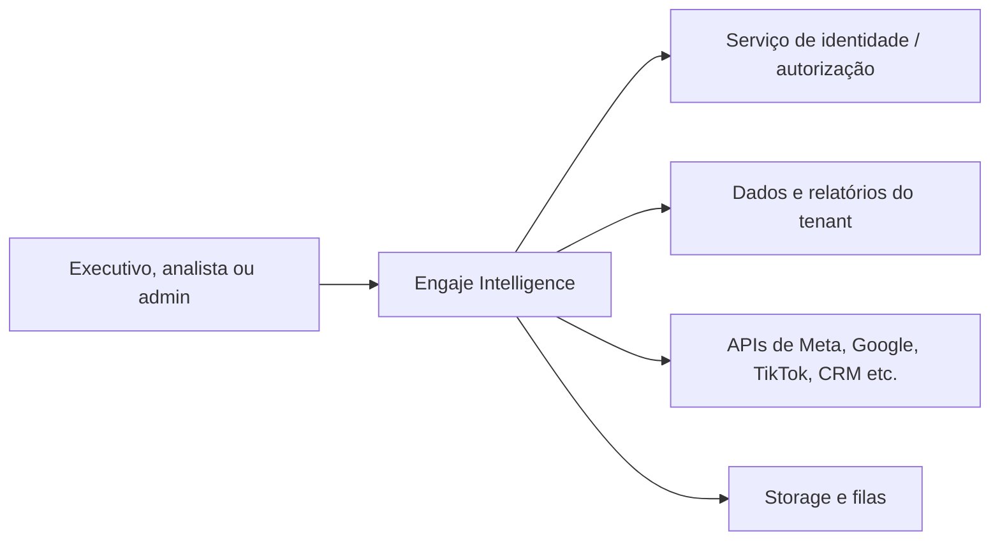
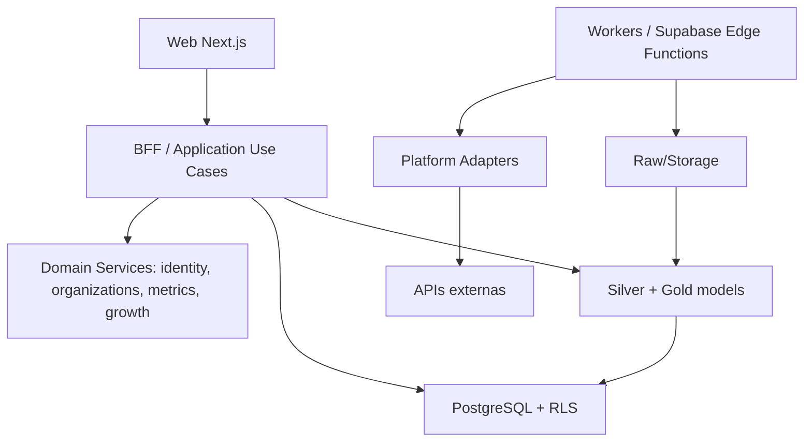

# Engaje Intelligence — Arquitetura-alvo, ADRs e gates
Status: arquitetura **proposta**, ainda não homologada.

## ADR-001: monólito modular como núcleo inicial
Contexto: crescimento por clientes e integrações, porém dados e equipe não justificam microserviços imediatos.
Decisão: Next.js/TypeScript com módulos de domínio explícitos (identity, organizations, integrations, analytics, audiences, funnels, growth, reporting), APIs/BFF autorizados e workers de coleta isolados.
Consequência: limites de domínio e módulos testáveis antes de serviços distribuídos. Reavaliar por SLO, volume e equipes.

## ADR-002: fonte operacional vs. base analítica
PostgreSQL mantém entidades transacionais; fatos de marketing usam grãos declarados e contratos Bronze → Silver → Gold. Não misturar respostas de APIs diretamente em gráficos.
Fatos distintos para desempenho de anúncios, detalhamentos demográficos e métricas comerciais; evitar junções que multipliquem investimento.

## ADR-003: autorização positiva e isolation by default
Identidade independente de permissões. Tenant obrigatório na aplicação e no banco; RLS, autorização da API, cache por escopo, objetos privados, credenciais protegidas. Nunca aceitar organization_id informado no frontend como autorização.
Ferramentas MCP herdam escopo e privilégios; execuções de escrita exigem políticas e aprovação.

## ADR-004: engine semântica independente da interface
Indicador = contrato com ID, versão, formula, fontes, grão, moeda, janela de atribuição, dimensões, agregabilidade e tratamento null.
Gráficos recebem datasets validados, não calculam a definição canônica de negócios.

## ADR-005: design governado por evidências
Design System compartilhado, biblioteca de gráficos, padrões de filtros/drill-down/estados, WCAG 2.2 AA e revisão visual responsiva. Cada tipo de gráfico responde uma pergunta.
No data => indisponível; nunca inventar barras, cidades, sexo×idade, receita ou sessões GA4.

## C4 nível 1 (contexto)

## C4 nível 2 (containers lógicos)

## Checklist de encerramento de fase (gate)
1. Requisitos e rastreabilidade (FR/NFR) implementados e documentados.
2. Revisão de código, segurança de dependências, migrações e segredos.
3. Testes unitários, integração e E2E pertinentes aprovados.
4. Isolamento por empresa, papéis e scope da API comprovados.
5. Fórmulas, datasets e atualidade reconciliados (se aplicável).
6. UX: testes reais com navegação, filtros, compreensão, empty states, teclado e responsividade.
7. Logs, alertas, procedimento rollback, relatório de release e aprovação.
8. Sem P0/P1 nem requisito obrigatório pendente no escopo.
Somente após evidência positiva de cada item aplicável: `APROVADA`. Caso contrário: `ABERTA/BLOQUEADA`.

## Política de migração
- Criar branch por lote coeso, PR pequeno com testes e plano de reversão.
- Não alterar produção por alterações de esquema sem migração/reversão e backup verificado.
- Não copiar segredos ou payloads pessoais para PRs, logs, relatórios de diagnóstico.
- Publicação só após validação de preview + autorização de mudança de risco.
- Próxima fase apenas depois do gate formal.
